# Pix no Brasil (2020 a 2026): o que ele substituiu e para onde cresce

Análise de ponta a ponta com dados abertos do Banco Central: coleta por API, limpeza em Python, consultas em SQL, análise em notebook, planilha em Excel e dashboard em Power BI.

**Pergunta de negócio:** quanto o Pix cresceu desde o lançamento e quais meios de pagamento ele substituiu? Onde estão as oportunidades e os riscos?

**Resposta curta:** o Pix já responde por 56% das transações de pagamento do país. Ele substituiu principalmente o dinheiro em espécie e as transferências antigas, estagnou o cartão de débito e não freou o cartão de crédito. O crescimento agora vem de mais uso por pessoa, sobretudo no comércio.

## Principais resultados

| # | Achado | Número |
|---|---|---|
| 1 | Volume anual multiplicou por 9 em quatro anos | 8,0 bi de transações em 2021 → 71,3 bi em 2025 |
| 2 | Crescimento está desacelerando | +109% (out/2022) → +14% (out/2026), sobre o mesmo mês do ano anterior |
| 3 | Cresce o uso, não a base | Usuários PF +32% e transações por usuário +165% entre out/2022 e out/2026 |
| 4 | Virou meio de pagamento no comércio | Pagamentos a empresas passaram as transferências entre pessoas em set/2025 |
| 5 | Maior meio de pagamento do país em quantidade | 56% das transações no 2º tri/2026 |
| 6 | Substituiu dinheiro e transferências antigas | Saques -46% e cheques -80% desde 2019; débito parado desde 2023; crédito +180% |
| 7 | Uso mais intenso no Norte e Nordeste | 63 Pix por pagador/mês no Amazonas contra 32 em Santa Catarina |
| 8 | Fraude é rara, mas pouco se recupera | 4 contestações aceitas a cada 100 mil Pix; só 13% do valor é devolvido (2026) |

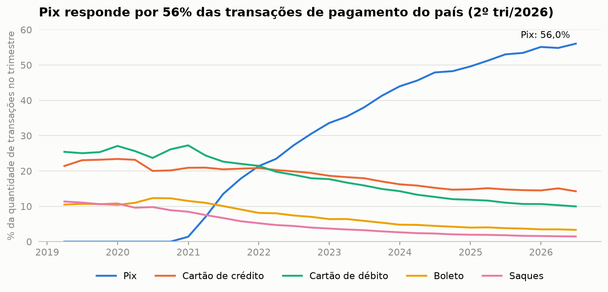

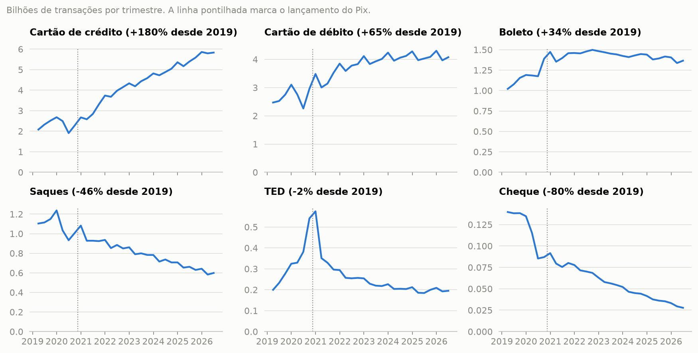

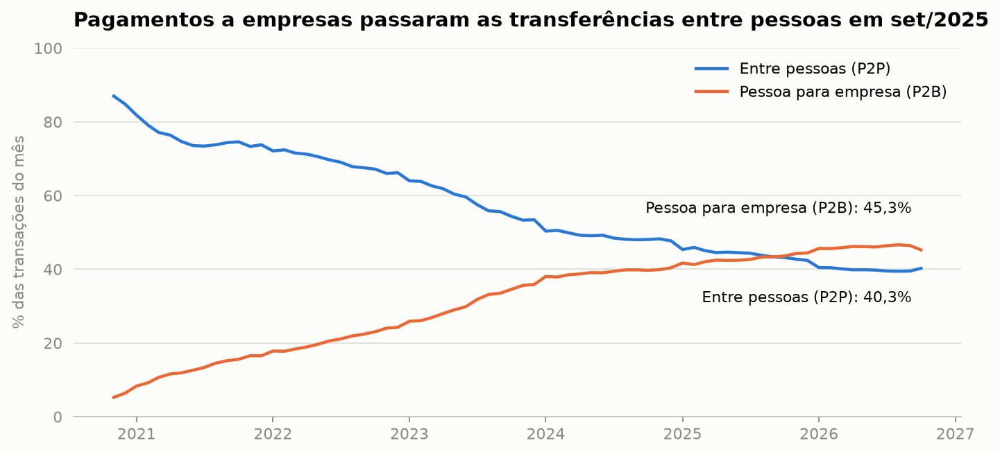

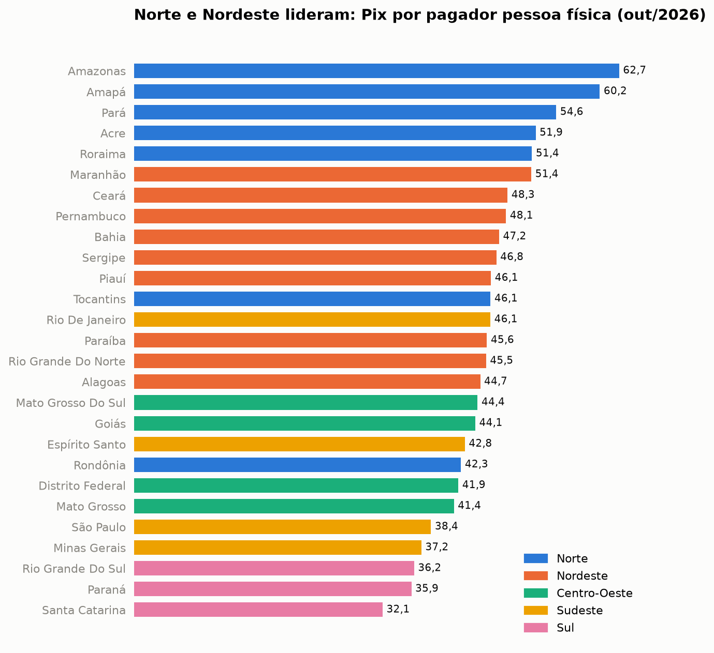

A análise completa, com todos os gráficos e conclusões, está em [notebooks/01_analise_pix.ipynb](notebooks/01_analise_pix.ipynb).

## Recomendações

1. **Comércio e adquirência:** tratar o QR Code dinâmico como forma padrão de cobrança (43% das transações em 2026). Quem depende de receita de débito precisa rever o modelo.
2. **Bancos e fintechs:** a disputa é por ser a conta principal, já que o crescimento vem de uso por pessoa. Norte e Nordeste têm a maior intensidade de uso.
3. **Crédito:** o cartão de crédito seguiu crescendo ao lado do Pix; produtos que unem os dois ocupam o espaço que o Pix ainda não alcança.
4. **Segurança:** priorizar velocidade de bloqueio. Cerca de metade do valor fraudado se perde porque a conta de destino já está sem saldo.

## Dashboard (Power BI)

Seis páginas, com filtro de ano sincronizado e fundos desenhados no Figma (`powerbi/fundos/`). O roteiro de montagem, com os campos de cada visual e os valores de conferência, está em [powerbi/roteiro_dashboard.md](powerbi/roteiro_dashboard.md).

| Página | O que responde |
|---|---|
| Visão geral | Quanto o Pix cresceu e se o ritmo está caindo |
| Como o Pix é usado | Pessoas x empresas, forma de iniciação, uso por pessoa |
| Pix x outros meios | Quais meios de pagamento perderam espaço |
| Onde é mais usado | Uso por estado e relação com o ticket médio |
| Setores e fraudes | Setores que mais recebem e quanto da fraude é recuperado |
| Conclusões | Achados, recomendações e limitações |

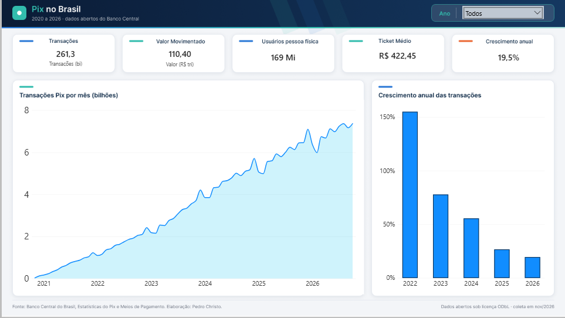

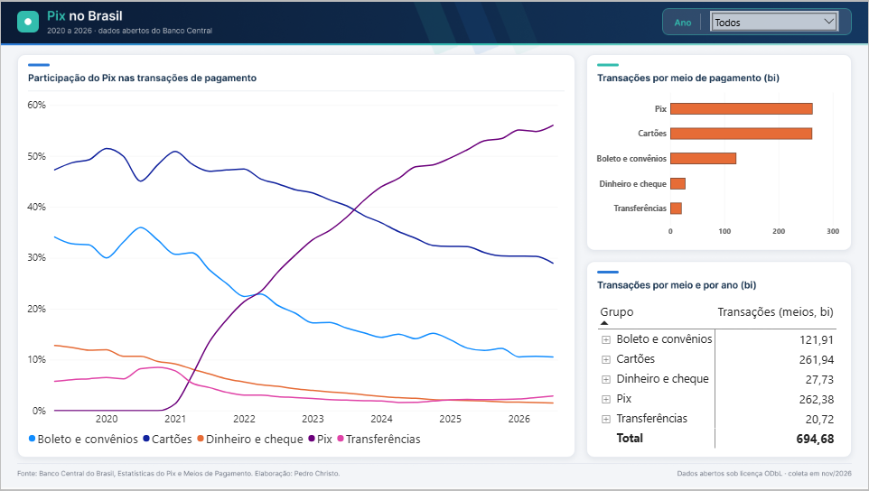

<details>
<summary>Ver as outras páginas e o modelo de dados</summary>

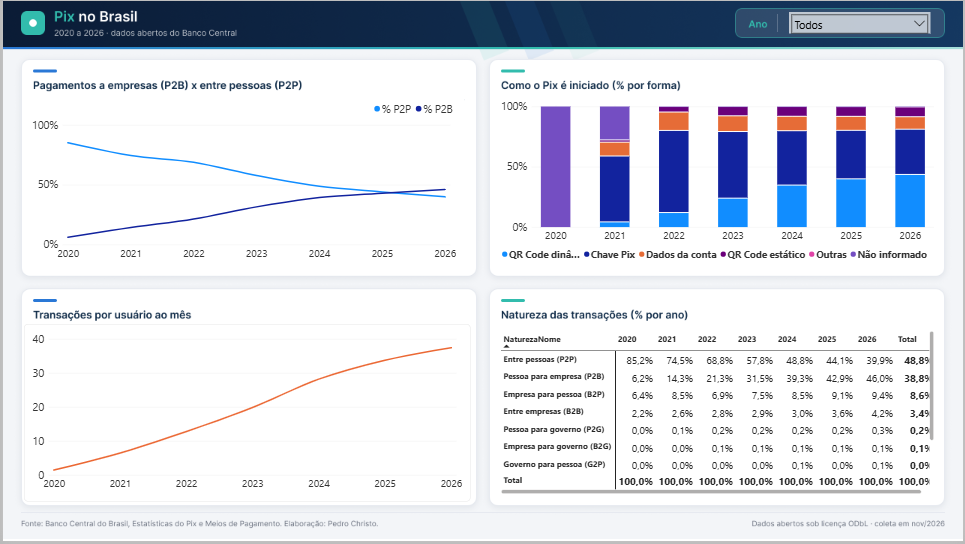

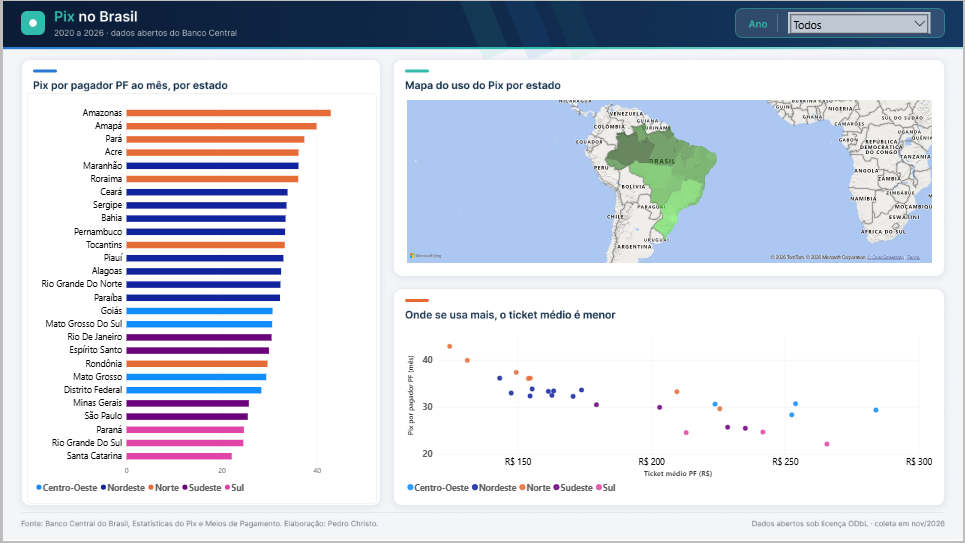

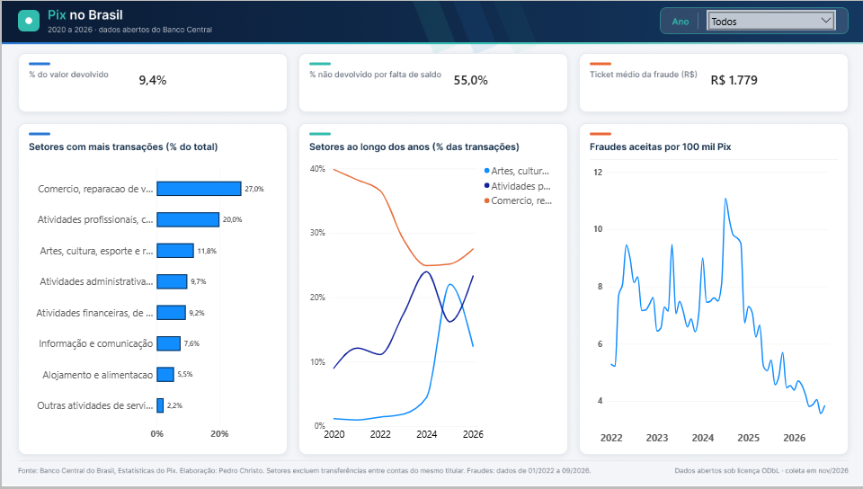

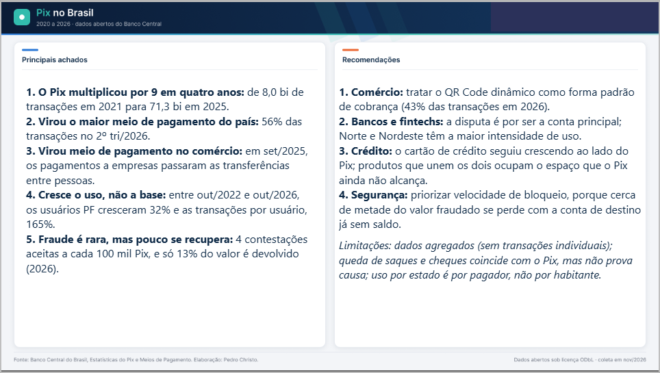

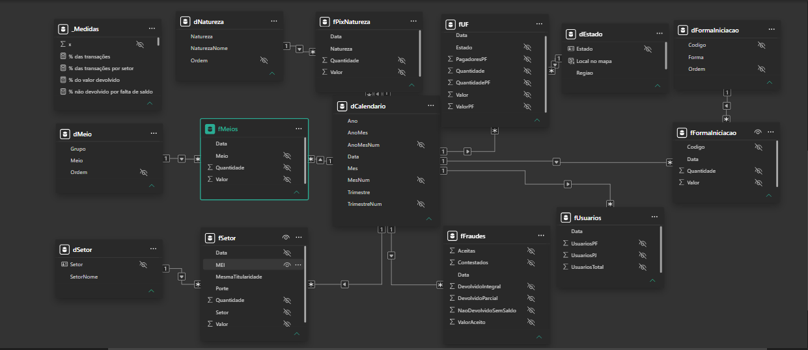

</details>

## Dados

| Tabela | Fonte | Período |
|---|---|---|
| Transações Pix por perfil, região, idade e natureza | BCB, Estatísticas do Pix | 11/2020 a 10/2026 |
| Transações por município | BCB, Estatísticas do Pix | 11/2020 a 10/2026 |
| Recebedores por setor (CNAE) e porte | BCB, Estatísticas do Pix | 11/2020 a 10/2026 |
| Chaves por instituição e usuários no DICT | BCB, Estatísticas do Pix | 11/2020 a 10/2026 |
| Contestações por fraude (MED) | BCB, Estatísticas do Pix | 01/2022 a 09/2026 |
| Pix, TED, boleto, cheque, cartões e saques | BCB, Meios de Pagamento | 2019 a 2º tri/2026 |

- Portal: https://dadosabertos.bcb.gov.br/dataset/pix
- Licença: Open Database License (ODbL). Coleta em 11/11/2026.
- Dicionário de dados: [docs/dicionario_de_dados.md](docs/dicionario_de_dados.md)

## Método

| Etapa | Arquivo | O que faz |
|---|---|---|
| Coleta | `src/coleta.py` | Baixa 8 tabelas da API OData do BCB, mês a mês, com novas tentativas em caso de falha |
| Limpeza | `src/preparo.py` | Padroniza categorias, remove mês incompleto, converte unidades e gera 17 tabelas resumidas |
| SQL | `sql/*.sql` e `src/rodar_sql.py` | 6 consultas em DuckDB com CTE, JOIN e window functions (LAG, RANK, participação acumulada) |
| Análise | `notebooks/01_analise_pix.ipynb` | Nove perguntas, cada uma com gráfico e conclusão |
| Planilha | `excel/pix_analise.xlsx` | Resumo com fórmulas, tabelas dinâmicas, segmentação e gráfico dinâmico |
| Dashboard | `powerbi/analise-pix-brasil-power-bi.pbix` | Modelo estrela (7 fatos, 6 dimensões), 37 medidas DAX e 6 páginas |

### Cuidados com os dados
- **Duas fontes, dois totais.** As tabelas do Pix contam o que é liquidado no SPI; a de meios de pagamento inclui também o Pix liquidado fora do SPI e mostra cerca de 10% a mais em quantidade (09/2026). Nunca somo ou comparo uma com a outra diretamente.
- **Conferência com o BCB.** Em 2025, a tabela de meios de pagamento soma 79,6 bilhões de transações Pix e R$ 35,3 trilhões, em linha com a ordem de grandeza divulgada pelo BCB no Relatório de Gestão do Pix 2023-2025 (perto de 80 bilhões e acima de R$ 35 trilhões). No SPI, o mesmo ano soma 71,3 bilhões e R$ 29,6 trilhões.
- **Mesma titularidade.** Em 2026, 10% das transações e 39% do valor são transferências entre contas do mesmo titular. Elas inflam valor e ticket médio; a análise de setores as exclui, como faz o BCB. Sem elas, set/2025 soma 5,5 bilhões de transações e R$ 1,7 trilhão, igual ao Relatório de Política Monetária de dez/2025.
- **Contestações de fraude não são comparáveis antes e depois de out/2025.** Em 1º/10/2025 entrou no ar o autoatendimento do MED (botão de contestação no aplicativo), e as contestações quase triplicaram sem aumento nas aceitas. Para evolução da fraude, uso as contestações aceitas.
- **"NA" não é nulo.** A base usa o texto "NA" como categoria. Sem `keep_default_na=False`, o pandas apagaria esses valores.
- **Mês incompleto.** A tabela de municípios traz o mês corrente parcial; ele é descartado.
- **Parâmetro da API.** O parâmetro de data é a data inicial, não um filtro; para um mês exato uso `$filter`.

## Como reproduzir

```
pip install -r requirements.txt
python src/coleta.py        # cerca de 50 minutos; a API é lenta
python src/preparo.py
python src/rodar_sql.py
jupyter notebook notebooks/01_analise_pix.ipynb
```

As três maiores tabelas brutas não estão no repositório (ver `.gitignore`); o primeiro comando as recria.

## Limitações
- Dados agregados: sem transações individuais, horário ou perfil detalhado do pagador.
- As quedas de saques, cheques e TED coincidem com a alta do Pix, mas séries agregadas não provam causa.
- Uso por estado é medido por pessoa que pagou, não por habitante. Próximo passo: cruzar com a população do IBGE.
- Valor total e ticket médio incluem transferências entre contas do mesmo titular, exceto na análise de setores.
- O setor "artes, esporte e recreação" saltou de 4,5% para 22% das transações entre 2024 e 2025. Ele inclui a classe de apostas (CNAE 92), e o salto coincide com o mercado regulado de apostas, mas a base não abre o setor por classe: é hipótese, não prova.
- Siglas de forma de iniciação: QRDN e QRES constam do Informe SPI 013/2021; DICT (chave Pix) e MANU (dados da conta) seguem a descrição do BCB; INIC, AUTO, APDN e APES (menos de 1%) têm leitura provável (iniciador de pagamento, Pix Automático e Pix por aproximação), ainda sem fonte primária.

## Referências
- BCB, [Estatísticas do Pix (dados abertos)](https://dadosabertos.bcb.gov.br/dataset/pix)
- BCB, [Informe SPI 013/2021](https://www.bcb.gov.br/content/estabilidadefinanceira/informesspi/InformeSPI-013-2021.pdf) (códigos QRES e QRDN)
- BCB, [Relatório de Política Monetária, dez/2025, boxe sobre pagamentos por atividade econômica](https://www.bcb.gov.br/content/ri/relatorioinflacao/202512/rpm202512b3p.pdf)
- BCB, [Estudo Especial 119/2024: mercado de apostas online](https://www.bcb.gov.br/conteudo/relatorioinflacao/EstudosEspeciais/EE119_Analise_tecnica_sobre_o_mercado_de_apostas_online_no_Brasil_e_o_perfil_dos_apostadores.pdf)
- BCB, [Nota sobre o Relatório de Gestão do Pix 2023-2025](https://www.bcb.gov.br/detalhenoticia/21219/nota)
- BCB, [Manual Operacional do DICT](https://www.bcb.gov.br/content/estabilidadefinanceira/pix/Regulamento_Pix/X_ManualOperacionaldoDICT.pdf) (limite de chaves por conta)
- BCB, [Diretório de Identificadores de Contas Transacionais (DICT)](https://www.bcb.gov.br/estabilidadefinanceira/dict)

## Próximos passos
- População do IBGE para métricas por habitante.
- Separar o setor de recreação por classe CNAE, se o BCB publicar esse detalhe, para testar a hipótese das apostas.
- Publicar o dashboard no Power BI Service com atualização mensal.

## Autor
Pedro Christo · [LinkedIn](https://www.linkedin.com/in/pedro-christo-9001b62b4/)
